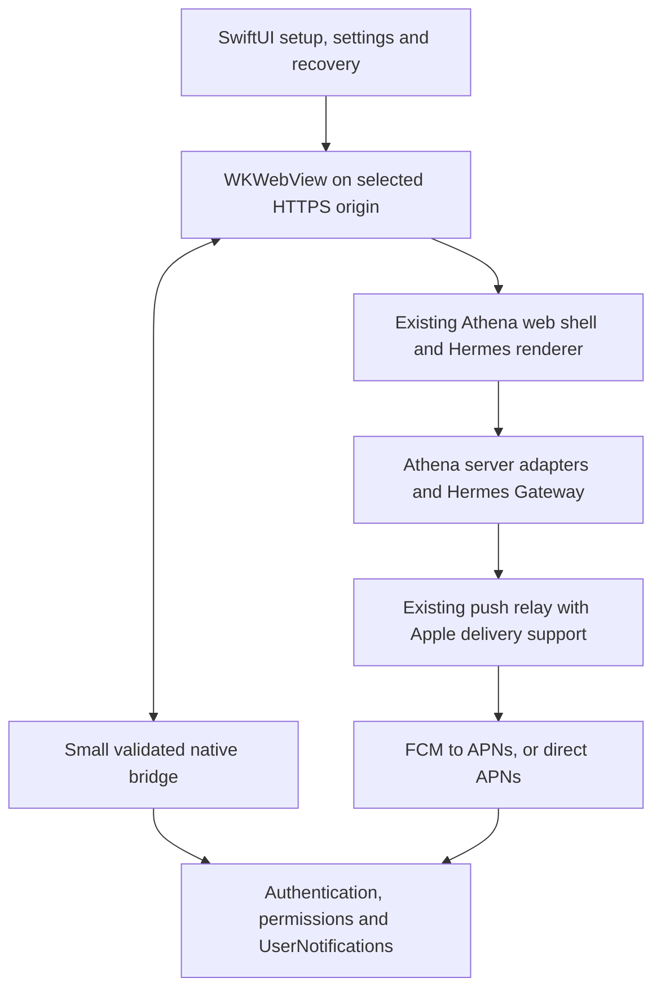

# iPhone and iPad app implementation plan

Research date: 4 November 2026. Repository baseline: `origin/main` at
`4c2f3b3`. This is a proposal, not an implementation or a release commitment.
Estimates are engineering judgments; platform requirements below link to primary
sources and should be checked again when implementation starts.

## Recommendation

Build one universal iPhone/iPad app in `apps/ios`, using SwiftUI for the native
shell and `WKWebView` for the existing hosted Athena interface. Match the current
Android product: connect to a user-selected Athena HTTPS server, use the same
Hermes conversations and settings, and add native authentication, notifications,
permissions, recovery, and device integration.

Keep the existing React renderer, browser shell, server adapters, and authoritative
Hermes state. Do not port chat to SwiftUI, introduce another conversation store,
or rebuild Android around a cross-platform framework. The native app should own
connection and operating-system concerns; the web app should continue to own
chat, profiles, configuration, drafts, approvals, and selection.

Start with a short feasibility build on an iPhone and iPad, then a private
TestFlight beta. Treat long-term distribution as an early product decision:
TestFlight is suitable for iteration but its builds expire after 90 days.
[Apple TestFlight overview](https://developer.apple.com/help/app-store-connect/test-a-beta-version/testflight-overview/)

Assumptions for this plan: one configured server and one Athena window at a time;
existing self-hosted Hermes accounts; no new subscription or hosted AI service;
foreground voice recording; no offline agent execution. Use iOS/iPadOS 18 as a
provisional deployment floor, then confirm it against the owner's devices and
the pinned renderer during feasibility. This is a project choice, not an Apple
requirement. Build with a supported current Xcode: Apple's published upload floor
is Xcode 26 with the iOS/iPadOS 26 SDK since 28 April 2026. SDK version and minimum
supported device OS are separate settings.
[Apple SDK requirements](https://developer.apple.com/news/upcoming-requirements/)

## What Android actually contains

The Android app is a Kotlin host for a remotely served web UI, currently version
`0.2.2` at this baseline. The server and renderer update independently of the
installed binary. It is not a separate native implementation of Hermes chat.

| Existing scope and evidence | iPhone/iPad equivalent for the first release |
| --- | --- |
| HTTPS server entry, validation, saved origin, setup cancellation: `ServerAddress.kt`, `MainActivity.kt` | Native Connect screen, normalized HTTPS origin, reconnect and change-server controls |
| Setup/loading/Access sign-in/Athena sign-in/ready/recovery states: `ConnectionCoordinator.kt` | Small native connection coordinator with the same user-visible states |
| Hermes browser sign-in with five-minute one-use PKCE handoff: `BrowserSignIn.kt`, `server/android-auth.mjs` | System authentication session plus a native cookie-store exchange |
| Separate Cloudflare Access bootstrap with encrypted callback: `AccessSignIn.kt`, `server/android-access.mjs` | iOS callback support and equivalent origin/state/expiry validation |
| Shared chat, profiles, Settings, action menus, searchable model picker: `README.md`, browser architecture | Reuse the hosted interface and its existing owners |
| Versioned, origin-restricted native bridge and capability handshake: `NativeBridge.kt`, `platform/android.ts` | Small iOS transport with negotiated capabilities; preserve Android protocol support |
| Native App settings, recovery controls, revision/connection/push diagnostics: `NativeAppSettings.kt`, `AppDiagnostics.kt` | SwiftUI settings/recovery surfaces available even when the web UI fails |
| File selection and microphone permission: `MainActivity.kt`, Android manifest | WebKit file input with system pickers, microphone permission and interruption handling |
| External links leave the privileged WebView: `MainActivity.kt` | Open ordinary external links in the system browser; keep authentication in its own session |
| Native local alerts plus optional FCM completion/error push: `NativeNotifications.kt`, `PushService.kt`, `server/android-push.mjs` | UserNotifications plus APNs-backed visible alerts, optionally through FCM |
| Draft-saving navigation admission: `platform/android-navigation.ts`, `platform/reload-safety.ts` | Reuse the saving/readiness decision before destructive host navigation |
| Failure simulations and Retry/End test: `ConnectionTest.kt`, `README.md` | Equivalent bounded development/recovery scenarios without changing the saved server |
| Signed APK updates, Stable/Latest main channels: `AppUpdates.kt`, `docs/android/releases.md` | TestFlight/App Store distribution; no IPA downloader or Android-style installer |

The durable Android push relay currently emits completion/error events for
conversations observed through its gateway relay. Its preference schema also
contains approval/input toggles, but this does not establish background delivery
for those events. First-release iOS parity means completion/error push with the
same documented coverage, not a promise of notifications for every server task
or every approval created on another device.

Relevant repository references:
[Android release process](android/releases.md),
[browser architecture](browser-architecture.md),
[mobile phone experience record](mobile-phone-experience-plan.md), and
[README Android instructions](../README.md#android-app).
The older mobile plans are useful context, not extra delivery gates.

## Architecture choices

| Approach | Fit for Athena | Decision |
| --- | --- | --- |
| SwiftUI shell with hosted `WKWebView` | Preserves the current server-origin model and Android scope; direct access to Apple authentication, notifications, and recovery APIs | Recommended |
| Capacitor | Useful when packaging a web application and adopting its plugin lifecycle; here it would add a second host framework around custom server selection and authentication | Keep as an alternative if bundled web assets become a firm requirement |
| Fully native SwiftUI or React Native chat | Reimplements rendering, tools, settings, streaming, and conversation behavior, with substantial ongoing upstream divergence | Outside this request's scope |
| Existing Home Screen PWA | Lowest installation effort and useful fallback; does not itself supply the proposed native recovery and authentication integration | Retain alongside the app |

Capacitor's configuration describes loading an external `server.url` as a
live-reload feature that is not intended for production. It is therefore not a
drop-in justification for pointing a stock Capacitor app at arbitrary Athena
servers. A production design would need to resolve that model explicitly.
[Capacitor configuration](https://capacitorjs.com/docs/config)

### Native and web ownership

The app keeps only its configured origin, connection stage, app metadata,
temporary authentication transaction, notification registration, and a bounded
pending notification destination. Do not copy transcripts or drafts into Swift
models. Use the persistent WebKit website data store for web cookies and browser
storage; use Keychain for native secrets such as pending handoff material and
push refresh credentials. Store the non-secret server preference in app settings.

Implement the WebView using `UIViewRepresentable` and a focused coordinator.
Use `WKNavigationDelegate` for navigation, failures, and content-process exits;
use `WKUIDelegate` for supported system UI and media permission decisions.
Do not grow a single controller to own authentication, push delivery, settings,
and connection logic. Keep these as a few small feature owners.

Retain a native App settings entry during loading, incompatible-server errors,
authentication, and renderer failure. Hide redundant native chrome only after
the web App settings entry is actually rendered and acknowledged, following the
Android handshake. Chat configuration remains in shared web Settings; there is
no need to port Android's legacy native Settings renderer and model menus.

### Bridge and compatibility

Introduce a narrow host adapter, for example `platform/native-host.ts`, exposing
platform identity, protocol version, capabilities, and request/reply transport.
Implement iOS with `WKScriptMessageHandler` or its reply-capable counterpart and
a document-start bootstrap. Retain the existing Android entry point and method
names behind its adapter. Do not pretend that iOS is `AthenaAndroid` or infer
privilege from the user-agent string.

Initial capabilities: host metadata, open App settings, open sign-in, native
notification permission/local notification, push registration, web readiness,
visibility, and safe navigation acknowledgment. Add file/share operations only
where ordinary WebKit behavior demonstrably needs help. Version capabilities
individually rather than assuming every installed binary supports the newest
server.

For every native message, validate protocol, request ID, method, payload size,
main frame, frame security origin, and the current WebView's configured origin.
Bind pending replies to a document generation; discard stale replies after
reload/server change. Reject subframes and foreign documents, and remove handlers
on teardown. `WKFrameInfo` exposes the main-frame and origin information needed
for this check.
[Apple WKFrameInfo](https://developer.apple.com/documentation/webkit/wkframeinfo)

Same-origin scripts remain part of the trusted server surface. A bridge cannot
make arbitrary server JavaScript safe, so expose specific operations and
user-mediated pickers, never unrestricted filesystem, Keychain, shell, or native
HTTP execution. Plugin frames must not acquire native privileges.

New server routes should use a small neutral namespace such as
`/api/athena/mobile/`. Keep `/api/athena/android/*`, its capability responses,
and existing installed-APK behavior working. Extract only the shared code needed
for iOS; do not perform a broad Android rewrite as preparation. Test old Android
with the new server and old iOS with later compatible servers. An older server
can offer basic web use where safe, with a clear explanation when native sign-in
or push is unavailable.

## Authentication and server connection

Authentication is the first feasibility gate. Safari/system authentication,
native `URLSession`, and `WKWebView` are separate cookie contexts; browser sign-in
must not assume it automatically signs in the WebView.

### Hermes sign-in

1. Validate and save the selected HTTPS origin. Keep origin-only semantics;
   reject credentials in URLs, unexpected paths, and insecure addresses.
2. Generate an S256 PKCE verifier/challenge and random state, bound to that
   origin and a five-minute native transaction.
3. Start the handoff through a small platform-neutral facade over the existing
   server protocol. Limit login paths and callbacks to known choices; never
   accept an arbitrary return URL supplied by web content.
4. Present `ASWebAuthenticationSession` using the callback API available on the
   deployment target. The browser signs into Hermes and explicitly approves
   moving the Athena session into the app. Return only a transaction reference
   and state in the callback, not plaintext credentials.
5. Exchange the transaction reference and verifier from native code. The server
   consumes the one-use transaction and returns the scoped session cookies.
6. Parse each `Set-Cookie` correctly and await every write to the selected
   `WKHTTPCookieStore` before loading Athena. Preserve Secure, HttpOnly, domain,
   path, and expiration attributes. Explicitly synchronize only the required
   native requests; do not create another long-lived refresh-token owner.
7. Invalidate transaction secrets on success, cancellation, expiry, server
   change, or supersession. A callback from an older attempt cannot replace the
   current session. Preserve session-token sign-in as the existing alternative.

Use the existing transfer semantics: moving a rotating refresh credential avoids
two independent clients racing to refresh the same session. Keep Android's
current return-and-exchange behavior valid while adding an iOS completion
callback. Start with an app-specific custom scheme so arbitrary self-hosted
domains do not require associated-domain administration. Validate state, origin,
transaction lifetime, and PKCE even with a system authentication session.
[Apple authentication session](https://developer.apple.com/documentation/authenticationservices/aswebauthenticationsession),
[Apple cookie store](https://developer.apple.com/documentation/webkit/wkhttpcookiestore)

### Cloudflare Access is a separate prerequisite

Access may block the native start/exchange endpoints before Athena can handle
them. Bootstrap Access through the system browser first. Extend the existing
encrypted handoff with a fixed iOS callback option, maintaining Android's
callback and its RSA-OAEP-SHA256/AES-GCM envelope. Implement and verify the
equivalent with Apple's Security/CryptoKit APIs, including cross-language test
vectors; Java's defaults must not determine the Swift implementation implicitly.

Bind the temporary key and state to the chosen origin, enforce the existing
short expiry, and install only the intended `CF_Authorization` cookie natively.
Do not transfer identity-provider cookies or a complete browser cookie jar.
Then run the separate Hermes flow. Test Access renewal as well as first login,
including native requests that need the Access cookie and a changed server
while authentication is open.

No blanket Access bypass is required by this plan. If the deployment cannot
complete the browser bootstrap or native cookie exchange, record that as a
blocking feasibility result before building the remaining app around it.

### Networking and recovery

Keep HTTPS and normal certificate validation, matching Android. Do not enable
global ATS exceptions or accept invalid/self-signed certificates silently.
Tailscale remains an independently configured network prerequisite; the app
does not need an embedded VPN. Diagnose unavailable VPN/DNS, TLS failure,
authentication required, HTTP 503, wrong server, incompatible integration, and
startup timeout separately where the platform supplies enough information.
Avoid representing generic connection failures as a definitive VPN diagnosis.
[Apple App Transport Security](https://developer.apple.com/documentation/security/preventing-insecure-network-connections)

Because the user may enter a local-network server, include an accurate
`NSLocalNetworkUsageDescription` where required and test the actual WKWebView
and native request paths on devices. Explain denied permission in recovery;
do not add Bonjour discovery or its declarations unless discovery is implemented.
Local-network permission and TLS trust solve different problems.
[Apple local-network privacy](https://developer.apple.com/documentation/technotes/tn3179-understanding-local-network-privacy)

Recovery offers Retry, Sign in, App settings, Change server, and diagnostic
details as appropriate. It retains the current WebView and origin data when
possible. Never clear browser storage, cookies, or drafts as an automatic
connection repair.

## Notifications and background behavior

### Recommended first implementation: FCM delivering through APNs

Reuse the existing Firebase project and server sender where practical, registering
an Apple app with its own bundle ID and APNs credentials. Add only Firebase
Messaging through Swift Package Manager; Analytics is unnecessary. Wire APNs
registration and token refresh explicitly in the SwiftUI app delegate adapter.
Firebase documents the APNs-key configuration and token mapping required for
Apple clients.
[Firebase Apple client setup](https://firebase.google.com/docs/cloud-messaging/ios/get-started)

This adds an Apple SDK dependency and requires the app distributor to manage its
APNs credentials in Firebase. Direct APNs is a viable alternative if avoiding
that dependency becomes a requirement: keep the same relay/store and add an
HTTP/2 provider with token authentication, environment/topic configuration,
expiry handling, invalid-token removal, and bounded retries. Choose one delivery
path after the spike; do not build both for the first release.
[Apple APNs requests](https://developer.apple.com/documentation/usernotifications/sending-notification-requests-to-apns)

### Server changes that cannot be skipped

The existing `firebase-messaging.mjs` sends Android data-only messages with an
Android priority/TTL block. It does not currently construct an iOS alert payload.
Copying `android-push.ts` and installing an Apple Firebase SDK will not provide
reliable completion alerts while iOS is suspended.

Extend the device record with an explicit platform/transport discriminator and
the fields required for the selected provider. Existing records default to
Android. Keep account, origin, installation, binding, token version, preference,
event ID, expiry, and revocation semantics. Read the current persistent store
without losing Android devices or pending events; migrate additively, with a
backup and a tested rollback policy before deployment.

For Apple delivery, generate a visible `aps.alert` completion/error notification
and suitable APNs push type, priority, expiration, and grouping metadata. Carry
an opaque event ID and bounded destination data for tap handling. The FCM HTTP
v1 API supports an `apns` configuration alongside platform-specific Android
settings.
[Firebase cross-platform messages](https://firebase.google.com/docs/cloud-messaging/customize-messages/cross-platform)

Retain generic notification text, not messages or transcript excerpts. Treat
session/profile identifiers as sensitive routing metadata and disclose the push
provider's involvement. Gate registration by authenticated account and selected
server. Revoke on sign-out, account/server change, and notification disablement;
reject stale binding/token updates. A local test checks permission/display; a
separate push test must exercise the actual server-to-device path.

### Delivery limits and duplicate handling

Do not depend on background JavaScript, a permanently connected WebView, silent
push, or a background execution mode to keep chat alive. The agent runs on the
server. Apple can throttle or omit background update notifications, so those
cannot be the completion-alert mechanism.
[Apple background push limits](https://developer.apple.com/documentation/usernotifications/pushing-background-updates-to-your-app)

Use `UNUserNotificationCenter` for authorization, local tests, foreground
presentation decisions, and notification taps. Suppress a foreground banner only
when the matching conversation is visible and connected. Expire the visibility
lease promptly when the app becomes inactive; a stale lease must not silently
hide a background completion. Deduplicate web/local/remote delivery by event ID
and document binding. With visible APNs alerts, do not promise the app can retract
an alert before display while suspended.

On a tap, verify the current origin and binding, wait for sign-in and renderer
readiness, then route through the existing session/profile owner. If credentials
are required, hold one bounded destination and resume after login. A later
explicit user selection takes precedence over an old pending tap. Never load an
arbitrary URL from notification data or switch servers automatically. Audit
profile ownership: the current Android relay's session destination alone is not
enough evidence that same-ID sessions in different profiles route correctly.

OS permission, Focus settings, connectivity, token validity, and provider
delivery still affect visible alerts. Verify suspended, system-terminated,
user-force-quit, offline, and foreground cases separately rather than promising
delivery in all closed-app states. The existing relay also cannot guarantee
new completion events across a server process restart while disconnected from
the gateway; durable queued events and durable gateway subscriptions are
different capabilities. Expanding to all server-originated work is later scope.

## iPhone, iPad, files, and voice

### iPhone

Retain the existing compact web navigation and bottom sheets. Native setup and
App settings use standard SwiftUI forms and sheets, system theme, accessible
labels, and comfortable touch targets. Keep the focused composer, caret,
attachments, and Send/Stop controls visible above the keyboard. Exercise long
drafts, rotation, dictation, text selection, and return from system pickers.
Do not automatically focus the composer on every chat selection.

Choose one owner for each inset: native layout handles system/window chrome;
the web shell handles its content and visual viewport. Measure this on devices
before adding keyboard height to CSS, since simultaneous native resizing and
web padding can double the offset. Preserve pinch zoom and existing scale
preferences. Do not enable WebView back/forward swipe navigation indiscriminately:
it must not reload an active chat or bypass the existing navigation admission.

### iPad

Ship a universal target with proper iPad layouts from the first beta. Wide
windows keep the shared sidebar/conversation layout; narrow windows use compact
navigation based on available width, not device name. Support portrait,
landscape, window resizing, Split View/Stage Manager where available, hardware
keyboard, pointer interaction, and iPadOS window controls without clipped chrome.
Apple's guidance expects adaptation to multitasking and resizable app windows.
[Apple multitasking guidance](https://developer.apple.com/design/human-interface-guidelines/multitasking),
[Apple window guidance](https://developer.apple.com/design/human-interface-guidelines/windows)

Use one Athena window initially. Supporting multiple windows of Athena itself is
separate from working beside other apps: defer it until draft ownership,
selection, push visibility, and notification destinations are explicitly scoped
per window. Constrain and anchor native popovers correctly on iPad. Keep normal
keyboard editing shortcuts; do not capture global shortcuts from the composer.
Expose existing New chat/navigation shortcuts only where conflicts are resolved.

### Files and voice

First verify existing HTML file inputs in WKWebView, including Files/iCloud Drive,
Photos, multiple selection, cancellation, MIME types, and return from a slow
provider. Add a narrow native picker adapter only for a confirmed gap. Support
the existing configuration import limits and preserve attachment ownership in
the current web bridge. Avoid transferring large chat attachments as base64
JSON over the native bridge.

For downloads and exports already offered by the web UI, verify authenticated
links, blob URLs, filenames, and PDF/image/text output. Use `WKDownload` or a
bounded native export/share fallback where necessary, with temporary-file cleanup
and a correctly anchored share sheet. Do not pass private authenticated URLs to
an external browser expecting it to share the app's cookies. Camera capture,
an incoming Share Extension, and cross-app drag-and-drop can follow after core
file selection works; do not advertise them before implementation.

Keep voice capture/transcription in the existing web pipeline initially. Add
`NSMicrophoneUsageDescription` and origin/frame-restricted WebKit media permission
handling. Test actual capture formats against the pinned transcription pipeline,
denial and re-enable, audio route changes, screen lock, phone/audio interruption,
and transcription after capture ends. No native Speech permission is needed
unless native speech recognition is actually added. Do not add background audio
entitlements to keep a socket alive.
[Apple WebKit media permission delegate](https://developer.apple.com/documentation/webkit/wkuidelegate/webview(_:requestmediacapturepermissionfor:initiatedbyframe:type:decisionhandler:))

## Draft safety, suspension, and web updates

Reuse `reloadReadinessAfterSaving()` and its distinction between host navigation
and a safe web UI update. Changing server, signing out, or reloading via native
App settings must await a matching request-ID acknowledgment after pending
preference writes and text drafts flush. Active replies, recordings,
transcription, file selection/uploads, and unsent attachments retain their
existing blocking rules. Keep the final post-await readiness check.

iOS can suspend or terminate the content process without an opportunity to
finish an asynchronous save. Keep existing ongoing draft persistence and flush
opportunistically on inactivity; never rely only on an app-background callback.
State the honest boundary: persisted text should recover; unsent attachments and
in-progress recording bytes are not promised to survive process death.

Handle `webViewWebContentProcessDidTerminate` with native recovery and a reload
from persisted state, without clearing storage or automatically resubmitting a
message. Existing Hermes routing/replay remains responsible for restoring chat
and streaming. Check the current route when recovery completes so a stale
notification does not undo a newer selection.
[Apple WebKit process termination callback](https://developer.apple.com/documentation/webkit/wknavigationdelegate/webviewwebcontentprocessdidterminate(_:))

Keep native and web releases separate. During feasibility, inspect WKWebView's
actual service-worker/cache behavior for this origin and verify the existing
safe-update flow. Do not assume installed-PWA behavior, or add another cache
layer just to mimic it. Incompatible native capabilities should show an update
or degraded-mode explanation with App settings still reachable.

## Distribution, review, and costs

| Route | Suitable use and constraint |
| --- | --- |
| Xcode development install | Fast feasibility work on the owner's devices; a free Personal Team requires reprovisioning after seven days and is not the push/distribution plan |
| Ad Hoc distribution with paid membership | Small known device set; registration/provisioning upkeep, limited to 100 devices per product family per membership year |
| Internal TestFlight | Recommended initial beta for eligible App Store Connect team users; up to 100 internal testers |
| External TestFlight | Wider beta without team roles; up to 10,000 testers and beta review for the first external build; still a 90-day build lifetime |
| Public or requested unlisted App Store app | Candidate for lasting installation and updates; both need review, and unlisted distribution is available to anyone with its link |

Sources: [Apple Personal Team limits](https://developer.apple.com/help/account/basics/about-your-developer-account),
[registered devices](https://developer.apple.com/help/account/devices/devices-overview),
[TestFlight](https://developer.apple.com/testflight/), and
[unlisted distribution](https://developer.apple.com/support/unlisted-app-distribution/).
Enterprise distribution is not the default for a personal community project.
Regional alternative distribution is unnecessary for the initial plan.

Budget for the Apple Developer Program, currently USD 99 per year with local
pricing at enrollment, access to a supported Mac/Xcode, and physical iPhone/iPad
testing. Check existing hardware and membership before buying anything. macOS
CI usage and any review/demo hosting are additional variable costs. Existing
Athena server and model usage continue separately; this plan adds no paid app
features.
[Apple enrollment and fees](https://developer.apple.com/help/account/membership/program-enrollment)

### Public-release feasibility

App Review is uncertain. Guideline 4.2 requires value beyond a repackaged website;
native recovery, sign-in, push, files, and iPad usability are the proposed value.
Audit remote functionality under 2.5.2 and plugins/chatbots under 4.7, including
native API restrictions and consent. Confirm applicable login, deletion,
generated-content, age-rating, and purchase requirements for the final product;
do not assume every rule requires new features in this existing-account client.
Guideline 5.1.2(i) requires disclosure and explicit permission for personal-data
sharing with third-party AI. Plan a clear consent flow before such transmission,
reflecting the configured server/providers, rather than relying only on a privacy
policy. A hosted WebView or bundled renderer does not establish compliance.
[Apple App Review Guidelines](https://developer.apple.com/app-store/review/guidelines/)

Provide a maintained reviewer-accessible demo server and account, independent of
the owner's private deployment, and explain remote agent execution honestly.
Keep branding explicitly unofficial and prepare accurate screenshots, support
details, and review notes. The demo must exercise the actual app capabilities.
[Apple App Review preparation](https://developer.apple.com/app-store/review/)

If review requires packaging a fixed renderer, stop and scope that change
separately: bundled assets would need API-origin configuration, cookie/CORS and
WebSocket authentication changes, plugin policy, and an explicit server/client
compatibility model. Simply moving `dist/` into Xcode would not preserve the
current same-origin application. Keep private development/Ad Hoc use available
while evaluating distribution; TestFlight is not a permanent review bypass.

Prepare an accurate privacy policy and App Store privacy answers covering chat
and uploads sent to the chosen server, its downstream AI services, device/push
identifiers, and any included SDK collection. WebView traffic matters to the
privacy declaration; do not declare that the app collects nothing merely because
the server is self-hosted.
[Apple App Privacy Details](https://developer.apple.com/app-store/app-privacy-details/)
Include and validate `PrivacyInfo.xcprivacy` and required-reason declarations for
actual native API/SDK use, including preferences APIs where applicable.
[Apple privacy manifests](https://developer.apple.com/documentation/bundleresources/privacy-manifest-files)

## Proposed repository changes

These names are a starting layout, not a requirement to create every abstraction
up front. Add files only when the corresponding phase needs them.

| Area | Proposed work |
| --- | --- |
| `apps/ios/Athena.xcodeproj`, app target and resources | Universal app, entitlements, usage descriptions, icons, privacy manifest; stable bundle ID chosen under the owner's team |
| `apps/ios/Athena/Connection/` | Connect screen, origin validation, connection coordinator and recoverable errors |
| `apps/ios/Athena/Web/` | WKWebView wrapper, validated bridge, navigation/media delegates and safe-navigation handshake |
| `apps/ios/Athena/Authentication/` | System browser sign-in, PKCE exchange, Access envelope, scoped cookie synchronization |
| `apps/ios/Athena/Notifications/` | Permission/local test, APNs/FCM registration, foreground presentation and pending-tap admission |
| `apps/ios/Athena/Settings/` | Native App settings, revisions, connection and notification diagnostics |
| `apps/web-desktop/src/platform/` | Narrow native-host adapter, iOS transport and capability-based notification/auth/lifecycle integration |
| `apps/web-desktop/src/upstream/` and `src/experience/` | Project existing engine readiness/selection into the host; shared App settings entry and measured viewport fixes |
| `apps/web-desktop/server/` | Shared mobile auth facade, fixed iOS callback support, additive push record/platform support and Apple payload construction |
| nginx and dev server routing | Expose only the required new mobile routes; preserve existing Android routes and Access protection |
| `.github/workflows/ios.yml` | Unsigned build and targeted checks on pull requests with a pinned macOS/Xcode combination |
| `.github/workflows/ios-testflight.yml` | Manually dispatched signed archive/upload from reviewed main; optional separate `ios-v...` tags later |
| `docs/ios/releases.md`, `README.md` | Installation, server requirements, sign-in, notification setup, versions, troubleshooting and release commands once implemented |

Never edit fetched `apps/desktop` or `apps/shared`. Keep client/web/gateway
revision reporting and capability compatibility visible; do not change repository
settings or activate parked renderer automation as part of this project.

## Delivery sequence and estimates

Estimates assume one engineer familiar with Athena, working days, a usable Mac
and two devices, and prompt access to Apple/Firebase configuration. They include
focused implementation and verification, not enrollment or review waiting time.
The numbers are planning ranges, not measured velocity.

### Phase 0 — Feasibility and distribution decision: 2–4 days

Create a disposable universal host and load the real hosted UI on iPhone/iPad.
Prove Access bootstrap, Hermes handoff, native cookie installation, WebSocket
reconnection, one file upload, microphone/transcription, persisted draft restore,
and keyboard/window resizing. Send one real background visible push. Record the
actual SDK/OS versions and deployment-floor result. Choose FCM/APNs transport and
the intended beta/lasting distribution route.

Exit: a short decision record and working spike evidence. If auth/capture/push
cannot work with the current server or distribution model, adjust the design
before investing in UI polish. This phase is an experiment, not a demand for a
formal release evidence system.

### Phase 1 — Native connection shell and bridge: 3–5 days

Add `apps/ios`, native setup/App settings/recovery, HTTPS normalization,
persistent WebKit storage, external-link handling, diagnostics, and capability
negotiation. Introduce the small native-host adapter only where needed, keeping
Android unchanged through its existing facade. Exercise wrong-server, timeout,
503, and incompatible-protocol recovery.

Exit: app starts, reconnects, and can always reach native recovery; foreign pages
and frames cannot invoke its bridge.

### Phase 2 — Production sign-in and safe lifecycle: 3–5 days

Make the spike's auth paths robust to cancellation, expiry, replay, origin
change, cookie refresh, Access renewal, and stale callbacks. Integrate request-ID
navigation admission, pending saves, draft restore, and content-process recovery.
Keep app-owned auth state small and existing Android routes compatible.

Exit: the owner can reliably connect using their real deployment and retain
saved drafts through ordinary suspend/reopen and reload behavior.

### Phase 3 — Notifications: 3–5 days

Add authenticated Apple registration, provider payloads, additive store handling,
permission/test surfaces, token rotation/revocation, visibility leases,
deduplication, and cold/warm notification routing with profile ownership.

Exit: completion/error alerts reach a suspended device and return to the correct
chat; sign-out/server changes invalidate old bindings; existing Android push
continues to work. Document limits uncovered by server restart testing.

### Phase 4 — Files, voice, iPad, and accessibility: 3–5 days

Resolve measured picker/export/capture issues. Finish keyboard/inset handling,
iPad resizing, popover anchors, pointer/hardware keyboard behavior, large text,
VoiceOver, contrast, reduced motion, and theme behavior. Do not add a parallel
native chat layout to fix a web CSS defect.

Exit: the primary send/read/switch/profile/settings/file/voice workflows work on
both device types with their actual software keyboards and system pickers.

### Phase 5 — Signing, beta, and installation docs: 2–4 days

Add CI/archive/upload, stable identifiers, app/web diagnostics, install/update
instructions, privacy material, and internal TestFlight distribution. Check an
in-place signed upgrade with existing cookies, settings, and a saved draft.
External review or public release preparation follows the chosen route.

Exit: a reproducible beta build installs on both devices, with a documented
support path and separate native/server versioning.

Total: **16–28 engineering days**, approximately **3–6 full-time weeks**, plus
calendar time for enrollment, feedback, or review. Allow another **3–5 days** for
issues the feasibility build cannot expose, particularly auth renewal, audio,
and App Store-driven packaging changes. A basic shell may run in a few days;
that is not the same as Android-scope parity. Public release is not included in
a guaranteed date.

Suggested reviewable PRs follow the phases, separating additive server/auth
changes from the native UI where useful. Each stays small and reversible.
Implementing the plan does not authorize merging, server deployment, Apple
account purchases, credential changes, or public submission.

## Verification proportional to the risks

Use focused automated checks for bridge origin/frame/schema rejection, sign-in
state/PKCE/replay/expiry and Access crypto vectors, stale document replies,
navigation admission, push binding/token rotation, migration compatibility, and
notification profile/selection races. Reuse existing Android/server tests for
modified shared paths. Run `pnpm typecheck` and `pnpm build` when web code changes;
run Xcode build and the relevant native unit tests when native code changes.

Browser WebKit emulation can catch layout and routing regressions, but it cannot
establish WKWebView cookie, keyboard, permission, audio, or suspension behavior.
For the initial platform beta, perform the following short real-device pass;
routine later styling fixes do not require repeating every item.

| Risk | Focused check |
| --- | --- |
| Authentication and privacy | Direct HTTPS and Access-protected deployment; cancellation, expiry, re-login, two attempts, server change, and wrong callback; no secrets in logs/URLs |
| Draft loss and double send | Long draft, chat/profile switch, background/lock, process termination, recover/reload, pending upload/recording/transcription; recover saved text without resending |
| Conversation races | Tap notification while signing in or switching chats; duplicate session IDs across profiles; newer manual selection wins |
| Background alerts | Foreground matching/other chat, background, terminated and force-quit separately, token rotation, denied permission, Focus, offline return, expired event, revoked binding |
| Mobile input | iPhone portrait/landscape with long composer, Photos/Files return, deny/re-enable microphone, audio interruption, transcription result |
| iPad usability | Full screen and narrow/resized window, hardware keyboard, floating/split keyboard where available, pointer, correctly anchored native sheets/popovers |
| Recovery and compatibility | Wrong server, unavailable network, TLS rejection, HTTP 503, old server/new client, old client/new server, content-process exit |
| Upgrade | Signed upgrade preserves origin, cookies, preferences, and saved draft; server and native updates remain independent |
| Accessibility | VoiceOver reading/focus and modal return, large text/zoom, reduced motion, sufficient contrast and usable controls |

Use the owner's iPhone and iPad first; add the smallest supported phone/window
and oldest supported OS in simulator or on an available device where they reveal
specific risk. Record gaps honestly instead of requiring a large device lab.

## Build, update, and rollback design

Keep native CI separate from Docker/Android releases. Pull requests run an
unsigned simulator build with a pinned Xcode selection and relevant tests.
Signed distribution runs only from reviewed main with temporary keychain/profile
material and no signing secrets exposed to untrusted pull-request code. Use
least-privilege App Store Connect upload credentials and separate push-provider
keys; never put either in the binary or Git. Firebase client configuration is
not a server credential, but should still be managed deliberately.

Assign increasing `CFBundleVersion` values on the distribution path and explicit
marketing versions; retain the bundle ID, team, and Keychain access groups across
upgrades. Capture source revision and build metadata in the app's diagnostics.
TestFlight serves beta updates; App Store serves reviewed production updates.
The app can direct users to the appropriate channel, but cannot replicate the
APK Stable/Latest main downloader. Do not promise that the app can delay an
OS-managed installation until its web safety guard approves it.

For a native regression, stop distributing the affected beta and ship a higher
build containing the fix or reverted code. Do not assume production users can
downgrade their installed app. For a server regression, use the existing immutable
Docker-digest rollback process, retaining runtime configuration, browser storage,
and volumes. Additive server protocol/store changes must retain that rollback
path or explicitly describe the backup/restore consequence before release.

## Decisions needed before implementation

The plan can proceed with the recommendations above. Confirm these during the
feasibility phase rather than leaving them to the final week:

1. Is the initial audience the owner's devices, a small beta group, or a public
   app? Recommended: owner's devices first, then internal TestFlight where team
   roles fit; external TestFlight for a wider group.
2. Is an Apple Developer membership already available, and which legal seller
   and stable bundle ID should own the app?
3. Which iPhone/iPad models and minimum OS must be supported? Recommended
   starting assumption: iOS/iPadOS 18+, subject to device and renderer checks.
4. Is Firebase acceptable for Apple notifications? Recommended: reuse FCM to
   APNs for the first release; use direct APNs only for a concrete requirement.
5. Which real authentication modes must pass: direct Hermes, Cloudflare Access,
   session token, or all three? Recommended: preserve the Android-supported
   paths rather than dropping Access to make the prototype easier.
6. If lasting App Store distribution is desired, who will maintain the isolated
   reviewer demo and resolve remote-plugin/review questions?

The first concrete implementation task should be the feasibility host and
authentication/push experiment. It resolves the largest unknowns while keeping
the shared Athena product and Android app intact.
